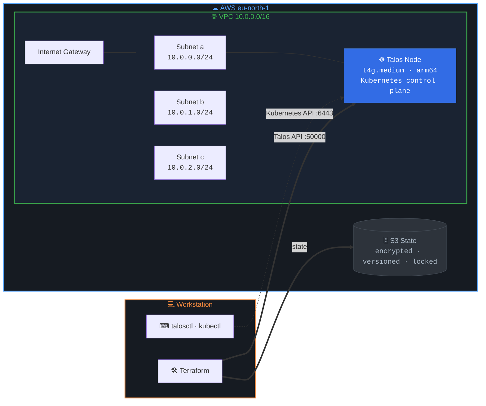
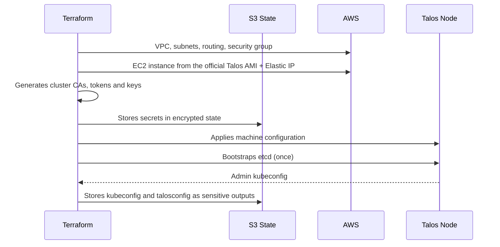
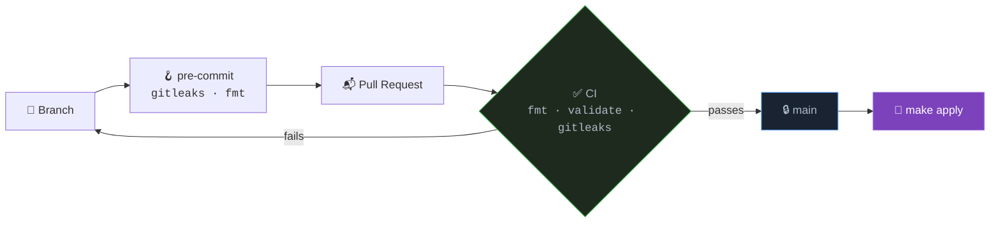

# AWS Kubernetes Platform


A Kubernetes platform on **AWS**, provisioned end to end with **Terraform**. The network, the compute nodes and a **Talos Linux** cluster are all declared as code, with remote state in S3, pinned versions, and a pull request workflow where every change is formatted, validated and scanned for secrets before it reaches `main`.

---

## Architecture Overview



---

## Provisioning Flow

Terraform takes a node from an empty EC2 instance to a running Kubernetes cluster. Talos has no SSH, so every step goes through its mTLS API.



**How it works:**

1. The **network** module creates the VPC, one public subnet per availability zone, the internet gateway and a security group
2. The **node** module looks up the official Talos AMI for the pinned version and starts the EC2 instances with an Elastic IP each
3. The **talos-cluster** module generates the cluster secrets, renders and applies the machine configuration, and bootstraps etcd
4. `make credentials` writes the admin kubeconfig and talosconfig to private files outside the repository

---

## Infrastructure Components

### State

| Component | Description |
|-----------|-------------|
| **S3 bucket** | Remote state for every stack, created by its own `bootstrap` stack |
| **Versioning** | Every previous state is kept, old versions expire after 90 days |
| **Encryption** | SSE-S3 at rest and a bucket policy that rejects requests without TLS |
| **Locking** | Native S3 lock file (`use_lockfile`), no DynamoDB table needed |
| **Protection** | Public access fully blocked and `prevent_destroy` on the bucket |

### Network

| Component | Description |
|-----------|-------------|
| **VPC** | `10.0.0.0/16` with DNS support and hostnames |
| **Subnets** | One public `/24` per availability zone, defined as a map so new zones never renumber existing ones |
| **Internet Gateway** | Default route for all subnets through a shared route table |
| **Security Group** | Free traffic between cluster nodes; Talos API (50000) and Kubernetes API (6443) only from admin CIDRs |

### Compute

| Component | Description |
|-----------|-------------|
| **EC2** | `t4g.medium` Graviton (arm64) instances, one per entry in the `nodes` map |
| **Talos AMI** | Looked up by version and architecture, restricted to Sidero Labs' AWS account |
| **Hardening** | IMDSv2 required, encrypted gp3 root volume |
| **Elastic IP** | Stable public address per node, so the cluster endpoint and certificates survive stop and start |

### Cluster

| Component | Description |
|-----------|-------------|
| **Talos Linux** | Immutable, API-managed OS built only for Kubernetes |
| **Machine secrets** | Cluster PKI generated by Terraform and kept only in encrypted state |
| **Machine configuration** | Rendered per role and patched with Talos 1.14 config documents (install disk, scheduling) |
| **Bootstrap** | etcd initialised once on the first control plane node |
| **Credentials** | Admin kubeconfig (auto-renewed by Terraform) and talosconfig as sensitive outputs |

---

## Repository Structure

```
.
├── infrastructure/
│   ├── bootstrap/                  # S3 bucket for Terraform state
│   │   └── environments/           #   dev.tfvars, dev.backend.hcl
│   ├── cluster/                    # Network, nodes and Talos cluster
│   │   └── environments/           #   dev.tfvars, dev.backend.hcl
│   └── modules/
│       ├── network/                # VPC, subnets, routing, security group
│       ├── node/                   # EC2 instances, Talos AMI lookup, Elastic IPs
│       └── talos-cluster/          # Secrets, machine config, bootstrap, credentials
│
├── .github/workflows/ci.yaml       # fmt, validate per stack, gitleaks
├── .pre-commit-config.yaml         # gitleaks and terraform fmt before every commit
├── .terraform-version              # Pinned Terraform version (tfenv)
└── Makefile                        # init, plan, apply, credentials per stack and environment
```

Each stack has its own state. Environments share the same code and only differ in their `environments/<env>.tfvars` and `<env>.backend.hcl` files.

---

## Delivery Workflow



- `main` is protected by a ruleset: pull request required, all CI checks required, no force pushes
- CI validates each stack with `terraform init -backend=false`, so it needs no cloud credentials
- Changes are applied from `main` after merge, so `main` always matches what is deployed

---

## Getting Started

**Requirements:** Terraform (version in `.terraform-version`), AWS CLI v2, `talosctl`, `kubectl`, `make`, `pre-commit`.

```bash
make login                 # authenticate to AWS
make init                  # providers and S3 backend
make plan                  # STACK=cluster and ENV=dev by default
make apply
make credentials           # kubeconfig and talosconfig to ~/.kube and ~/.talos

export KUBECONFIG=~/.kube/aws-platform-iac-dev.yaml
kubectl get nodes
```

The admin CIDR for the security group is taken from the current public IP at runtime and is never committed.

---

## Key Design Decisions

- **Stacks and modules**: state is split per stack so a failed apply in one can never affect another, and modules carry no provider configuration so any stack or environment can reuse them
- **Environments as data, not workspaces**: each environment has its own variable and backend file, keeping state and credentials fully separated
- **`for_each` over maps**: subnets, nodes and Elastic IPs have stable addresses, so adding or removing one never recreates the others
- **Talos on Graviton**: immutable nodes with no SSH and a fully declarative configuration, running on arm64 instances
- **Endpoint vs node addressing**: Talos API calls connect to the public Elastic IP but target the node's private IP, so the node never has to route traffic back to itself through the internet gateway
- **Pinned everything**: Terraform version, provider constraints with a committed lock file, and a single `talos_version` that drives both the AMI and the config contract

---

## Limitations

This is a single-environment lab rather than a production setup: the cluster runs one control plane node, nodes sit in public subnets instead of private subnets behind NAT, and `terraform apply` runs from a workstation because the AWS account's managed service control policy does not allow the IAM OIDC provider needed for keyless CI deployments.
