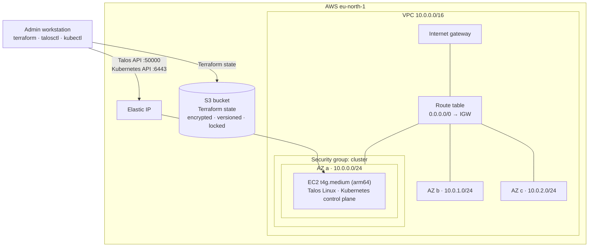

# aws-platform-iac

Infrastructure as Code for a Kubernetes platform on AWS. Terraform provisions the network, the compute and a [Talos Linux](https://www.talos.dev/) Kubernetes cluster from scratch, with remote state, version pinning, automated checks and a pull request workflow. The platform layer (Argo CD via GitOps Bridge) builds on top of it.

## Architecture



## Features

- **Network across three availability zones**: VPC, one public subnet per AZ, internet gateway and routing, ready to scale nodes out per AZ.
- **Least-privilege firewall**: nodes communicate freely with each other; the Talos and Kubernetes APIs are reachable only from the admin's current IP.
- **Immutable Kubernetes nodes**: Talos Linux on Graviton (arm64) instances, no SSH, managed entirely through an mTLS API.
- **Cluster lifecycle in Terraform**: secrets generation, machine configuration, etcd bootstrap and admin credentials are all Terraform resources.
- **Stable endpoint**: an Elastic IP per node keeps the Kubernetes endpoint and certificates valid across stop and start.
- **Remote state**: one S3 bucket with encryption, versioning, TLS enforcement and native locking, created by its own bootstrap stack.
- **Multi-environment layout**: the same code is deployed per environment with separate values and separate state.
- **Guarded delivery**: pre-commit hooks, CI checks and a protected `main` branch that only accepts reviewed pull requests with green checks.

## Best practices

| Practice | Implementation | Benefit |
|---|---|---|
| Separate stacks and modules | `bootstrap`, `cluster`, `platform` stacks; `network`, `node`, `talos-cluster` modules | Small blast radius per state; reusable building blocks |
| Environments as data | `environments/<env>.tfvars` and `<env>.backend.hcl` per stack | No duplicated code; environments cannot drift in logic |
| Remote, protected state | S3 with SSE, versioning, public access block, TLS-only policy, `prevent_destroy`, `use_lockfile` | Shared source of truth, recoverable, no concurrent writes |
| Reproducible toolchain | `.terraform-version`, `~>` provider constraints, committed `.terraform.lock.hcl` | Same versions locally and in CI; upgrades are explicit |
| Stable resource addressing | `for_each` over maps, `moved` blocks for refactoring | Adding or removing items never shifts other resources |
| Secrets never in git | Sensitive outputs, credentials written to `0600` files outside the repo, gitleaks locally and in CI | Keys cannot leak through the repository |
| Hardened nodes | Talos (immutable, API-only), IMDSv2 required, encrypted gp3 volumes | Minimal attack surface, no configuration drift on hosts |
| Consistent tagging and naming | Provider `default_tags` (`Project`, `Environment`, `ManagedBy`) and `<project>-<env>-<component>` names | Cost allocation, ownership and search by tag |
| Reviewed changes only | GitHub ruleset on `main`: PR required, required checks, no force push | Every change is formatted, validated and scanned before it lands |

## Repository structure

```
.
├── Makefile                      # entry point for all common commands
├── .terraform-version            # pinned Terraform version (tfenv)
├── .pre-commit-config.yaml       # gitleaks and terraform fmt before each commit
├── .github/workflows/ci.yaml     # fmt, validate per stack, gitleaks
├── docs/
└── infrastructure/
    ├── bootstrap/                # stack: S3 state bucket
    ├── cluster/                  # stack: network, nodes, Talos cluster
    │   └── environments/         # dev.tfvars, dev.backend.hcl
    ├── platform/                 # stack: Argo CD (planned)
    └── modules/
        ├── network/              # VPC, subnets, routing, security group
        ├── node/                 # EC2 instances, Talos image lookup, Elastic IPs
        └── talos-cluster/        # secrets, machine config, bootstrap, credentials
```

## Getting started

**Requirements:** Terraform (version from `.terraform-version`), AWS CLI v2, `talosctl` 1.14, `kubectl`, `make`, `pre-commit`.

```bash
make                     # list available commands
make login               # authenticate to AWS
make init                # initialise providers and the S3 backend
make plan                # preview changes (STACK=cluster, ENV=dev by default)
make apply               # apply changes
make credentials         # write kubeconfig and talosconfig to ~/.kube and ~/.talos

export KUBECONFIG=~/.kube/aws-platform-iac-dev.yaml
kubectl get nodes
```

Select another stack or environment with `STACK=bootstrap` or `ENV=<name>`.

## Documentation

| Document | Contents |
|---|---|
| [Architecture](docs/architecture.md) | Network, compute and cluster provisioning in detail |
| [Terraform design](docs/terraform-design.md) | Stacks, modules, environments, state and code conventions |
| [Security](docs/security.md) | Security controls per layer and known gaps |
| [Operations](docs/operations.md) | Change workflow, CI, credentials, running costs, common issues |
| [Decisions](docs/decisions.md) | Architecture decision records with trade-offs |

## Roadmap

- Argo CD installed through GitOps Bridge in the `platform` stack.
- Production hardening: private subnets with NAT, a load-balanced API endpoint for multiple control plane nodes, and CI-driven apply with OIDC (see [Decisions](docs/decisions.md)).
