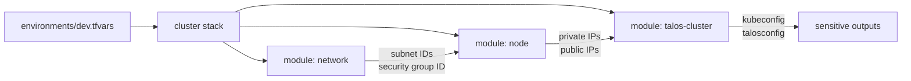
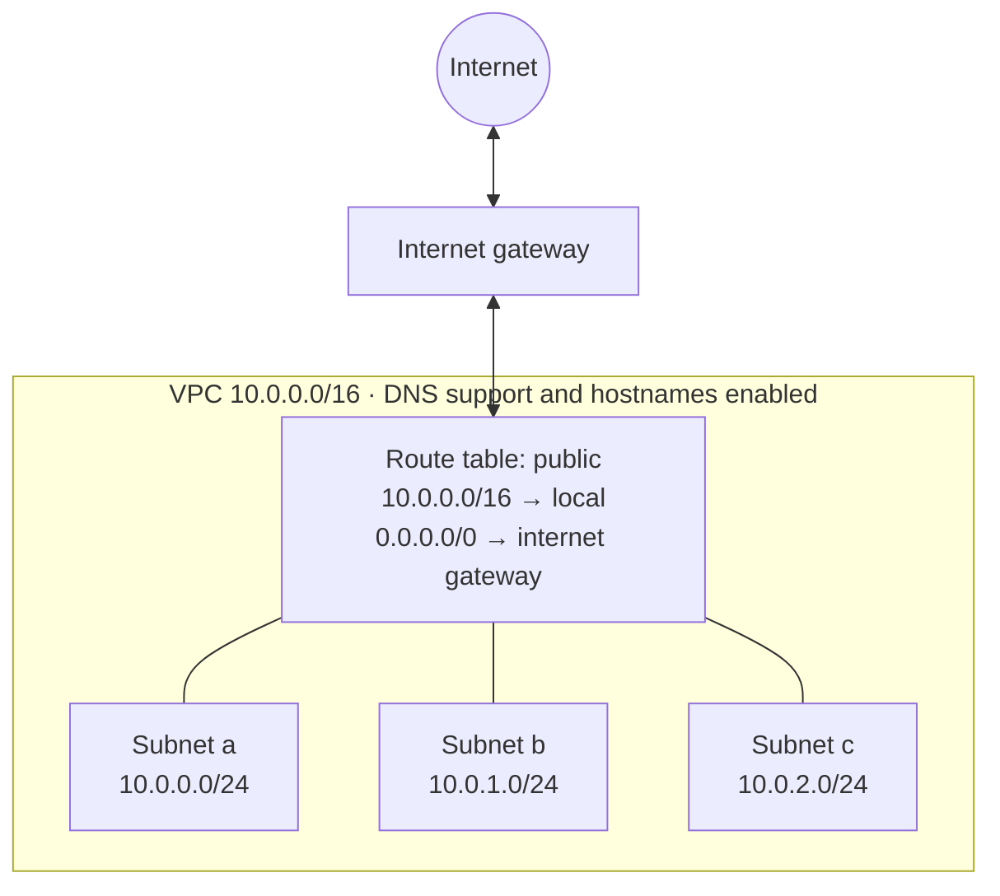
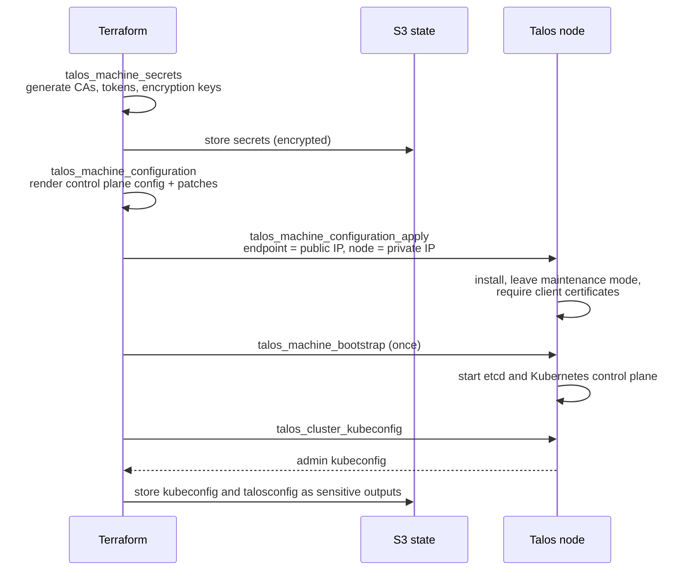

# Architecture

The platform is built in three layers: the network, the compute nodes, and the Kubernetes cluster running on them. Each layer is a Terraform module, composed by the `cluster` stack.



## Network



| Component | Configuration | Purpose |
|---|---|---|
| VPC | `10.0.0.0/16`, DNS support and hostnames | Isolated network; nodes get resolvable internal hostnames |
| Subnets | One `/24` per AZ (a, b, c), public IP on launch | A subnet is bound to one AZ, so three subnets allow nodes in three AZs |
| Internet gateway | Attached to the VPC | Outbound access for images and updates; inbound access to the APIs |
| Route table | Default route to the internet gateway, associated with every subnet | Traffic inside the VPC stays local; everything else goes to the gateway |

Subnets are defined as a map (`a = "10.0.0.0/24"`), so adding an AZ is a one-line change and existing subnets are never renumbered.

### Security group

All nodes share one security group. Rules are separate resources (`aws_vpc_security_group_ingress_rule` / `egress_rule`), each with its own state address.

| Direction | Source / destination | Ports | Purpose |
|---|---|---|---|
| Ingress | The security group itself | All | etcd, kubelet and pod network traffic between nodes |
| Ingress | Admin CIDRs | TCP 50000 | Talos API (`talosctl`, Terraform) |
| Ingress | Admin CIDRs | TCP 6443 | Kubernetes API (`kubectl`) |
| Egress | `0.0.0.0/0` | All | Images, updates, AWS APIs |

The self-referencing rule allows cluster traffic regardless of which IPs nodes receive. Admin CIDRs are supplied at runtime (`TF_VAR_admin_cidrs`) and never committed.

## Compute

| Setting | Value | Reason |
|---|---|---|
| Instance type | `t4g.medium` (2 vCPU, 4 GiB, Graviton arm64) | Enough memory for the control plane and Argo CD at low cost |
| Image | Official Talos AMI, looked up by version and architecture, owner restricted to Sidero Labs | Version-driven upgrades without hardcoded AMI IDs; protection against look-alike images |
| Metadata service | IMDSv2 required | Prevents SSRF-style credential theft through IMDSv1 |
| Root volume | 20 GB gp3, encrypted | Encryption at rest |
| `ignore_changes = [ami]` | Set | A new image does not replace the node; Talos upgrades in place with `talosctl upgrade` |
| Elastic IP | One per node | Stable public address, so the Kubernetes endpoint and certificates survive stop and start |

Nodes are a map of name to AZ letter:

```hcl
nodes = {
  cp-a = "a"
}
```

## Kubernetes cluster

Talos Linux is an immutable, minimal operating system built only to run Kubernetes. It has no shell and no SSH; all management goes through an mTLS-protected API on port 50000. A node's entire configuration is a declarative machine config.

### Provisioning flow



| Resource | Role |
|---|---|
| `talos_machine_secrets` | Generates all cluster PKI and tokens locally; pinned to the Talos version contract the cluster was created with |
| `talos_machine_configuration` (data) | Renders the control plane machine config from the secrets |
| `talos_machine_configuration_apply` | Pushes the config to each control plane node over the Talos API |
| `talos_machine_bootstrap` | Initialises etcd on the first control plane node, once per cluster |
| `talos_cluster_kubeconfig` | Retrieves an admin kubeconfig and renews its certificate when it is within 720 hours of expiry |
| `talos_client_configuration` (data) | Builds the admin talosconfig |

### Configuration patches

Talos 1.14 uses separate typed configuration documents. Patches target those documents directly:

| Document | Patch | Reason |
|---|---|---|
| `UnattendedInstallConfig` | Install disk selected with `disk.dev_path == "/dev/nvme0n1"` | EBS volumes appear as NVMe devices on Nitro instances |
| `KubeNodeConfig` | Remove control plane taints | Single-node cluster: workloads must be schedulable on the control plane |

### API addressing

Every Talos API call uses two addresses:

- **endpoint**: the public Elastic IP, reachable from where Terraform runs;
- **node**: the private IP, which is how the node identifies itself.

Targeting a node by its public IP would make the Talos API proxy the request to itself through the internet gateway, where the security group rejects it. The `talos-cluster` module therefore takes `control_plane_endpoints` (public) and `control_plane_nodes` (private) as separate inputs, and the generated talosconfig uses the same split.

### Scaling

Adding `cp-b = "b"` and `cp-c = "c"` to `nodes` creates three control plane nodes in three AZs. For a multi-node control plane, the Kubernetes endpoint should move from the first node's IP to a load balancer or shared address, and control plane taints would normally be kept.
