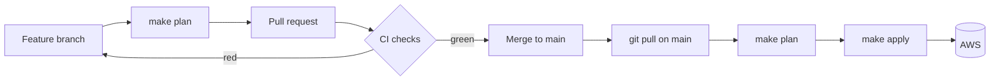

# Operations

## Change workflow



- Changes reach `main` only through pull requests with all required checks green.
- `apply` is run from `main` after merge, so `main` always describes what exists in AWS.
- Plans are reviewed before applying, with particular attention to destroy (`-`) and replace (`-/+`) actions.

## Checks

| Stage | Check | Purpose |
|---|---|---|
| pre-commit | `gitleaks` | Blocks secrets in staged changes |
| pre-commit | `terraform fmt` | Formats Terraform files automatically |
| CI | `fmt` | Fails on unformatted files |
| CI | `validate (bootstrap)`, `validate (cluster)` | Validates each stack with `terraform init -backend=false`, without AWS credentials |
| CI | `gitleaks` | Scans the full git history |

All four CI checks are required by the ruleset on `main`.

## Commands

| Command | Action |
|---|---|
| `make` | List commands |
| `make login` | Authenticate to AWS with short-lived credentials |
| `make init` | `terraform init` with `environments/$(ENV).backend.hcl` |
| `make plan` | `terraform plan` with `environments/$(ENV).tfvars` |
| `make apply` | `terraform apply` with `environments/$(ENV).tfvars` |
| `make credentials` | Write kubeconfig and talosconfig to private files |
| `make fmt` | Format all Terraform files |

`STACK` defaults to `cluster` and `ENV` to `dev`. The Makefile also sets `TF_VAR_admin_cidrs` to the operator's current public IP. Run `make init` after cloning or after adding a module or provider.

## Cluster access

```bash
make credentials
export KUBECONFIG=~/.kube/aws-platform-iac-dev.yaml
export TALOSCONFIG=~/.talos/aws-platform-iac-dev.yaml

kubectl get nodes
talosctl services
talosctl health
talosctl dashboard
```

The talosconfig targets nodes by private IP through the public endpoint, so `talosctl` commands work without extra flags.

## Running costs

Prices for eu-north-1.

| Resource | Running | Stopped |
|---|---|---|
| EC2 t4g.medium | ~0.034 USD/h | – |
| Elastic IP | ~0.005 USD/h | ~0.005 USD/h |
| EBS gp3 20 GB | ~1.7 USD/month | ~1.7 USD/month |
| VPC, subnets, gateway, routing, security group | free | free |
| S3 state | < 0.01 USD/month | |

Nodes are stopped outside working hours. Talos keeps etcd and all configuration on disk, and the Elastic IP keeps the endpoint stable, so the cluster resumes unchanged after a start. Terraform does not track the running state of an instance, so stopping a node does not create drift.

## Common issues

| Symptom | Cause | Resolution |
|---|---|---|
| `No valid credential sources found` / `login session has expired` | AWS session expired | `make login` |
| Two security group rules replaced in the plan | The operator's public IP changed | Expected; apply |
| `tls: certificate required` from `talosctl --insecure` | The node has left maintenance mode | Use `TALOSCONFIG` instead of `--insecure` |
| `kubectl get nodes` returns nothing right after bootstrap | The kubelet has not registered yet | Retry after a minute |
| A run waits for the state lock | Another `plan`/`apply` holds the lock | Wait; only `force-unlock` when no run is active |
| Talos rejects a config patch with an "incompatible with v1alpha1 config" error | Patch uses legacy fields that moved to typed documents in Talos 1.14 | Patch the typed document (`UnattendedInstallConfig`, `KubeNodeConfig`, …) |
| Talos API calls time out while port 50000 is open | The node is addressed by its public IP | Use `node` = private IP, `endpoint` = public IP |

Node diagnostics without SSH: `talosctl dmesg`, `talosctl logs <service>`, or the EC2 console's system log and instance screenshot.
