# Security

```mermaid
flowchart LR
    subgraph repo["Repository"]
        precommit["pre-commit: gitleaks"]
        ci["CI: gitleaks on full history"]
        rules["Protected main"]
    end
    subgraph state["Terraform state"]
        enc["Encrypted · versioned · private · TLS only"]
    end
    subgraph net["Network"]
        sgr["Security group: admin IP only on 50000 / 6443"]
    end
    subgraph host["Nodes"]
        talos["Talos: immutable, no SSH, mTLS API"]
        imds["IMDSv2 · encrypted volumes"]
    end
    subgraph creds["Credentials"]
        files["Sensitive outputs → 0600 files outside the repo"]
    end
    repo --> state --> net --> host --> creds
```

## Controls

| Layer | Control | Protects against |
|---|---|---|
| Repository | gitleaks as a pre-commit hook and as a CI job over the full history | Committing keys or tokens |
| Repository | GitHub ruleset on `main`: pull request required, required checks, no force push, no deletion, no bypass | Unreviewed changes and history rewrites |
| Repository | `.gitignore` for state, plans, variable files, kubeconfig, talosconfig, `.env` | Accidental commits of local secrets |
| State | SSE-S3 encryption, TLS-only bucket policy, public access block, versioning, `prevent_destroy` | Exposure or loss of the cluster PKI stored in state |
| AWS access | Short-lived credentials from `aws login`, no access keys | Long-lived key leakage |
| Network | Kubernetes and Talos APIs only reachable from admin CIDRs; admin CIDRs never committed | Internet-wide exposure of control plane APIs; publishing personal IPs |
| Network | Intra-cluster traffic allowed only between members of the cluster security group | Lateral access from other workloads in the VPC |
| Hosts | Talos Linux: read-only root filesystem, no shell, no SSH, API with mutual TLS | Host tampering, configuration drift, SSH attack surface |
| Hosts | IMDSv2 required, encrypted gp3 root volumes | Metadata credential theft, data at rest exposure |
| Images | AMI lookup restricted to Sidero Labs' account ID | Launching look-alike images from other publishers |
| Cluster PKI | Generated locally by Terraform, stored only in encrypted state | Keys in transit or in files |
| Credentials | `kubeconfig` and `talosconfig` are sensitive outputs, written by `make credentials` with `umask 077` to `~/.kube` and `~/.talos` | Credentials in terminal output or in the repository |
| Certificates | Talos rotates internal cluster certificates; the kubeconfig certificate is renewed by Terraform within 720 hours of expiry | Expired or long-lived admin certificates |

## Known gaps

These are deliberate trade-offs for a cost-limited environment. See [Decisions](decisions.md).

| Gap | Production approach |
|---|---|
| Nodes in public subnets with public IPs | Private subnets with NAT; API behind a load balancer or VPN |
| Apply runs from the operator's workstation | CI apply with GitHub OIDC and a role scoped to `main` |
| No scheduled drift detection | Nightly `terraform plan -detailed-exitcode` with alerting |
| SSE-S3 instead of a customer-managed KMS key | KMS key with a key policy limited to the state role |
| Single control plane node | Three control plane nodes across AZs |
