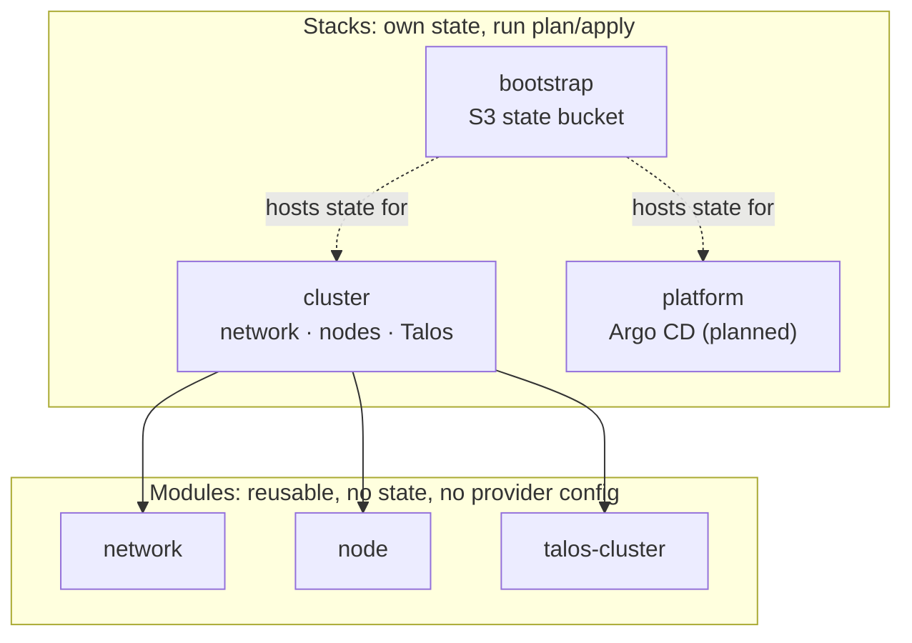
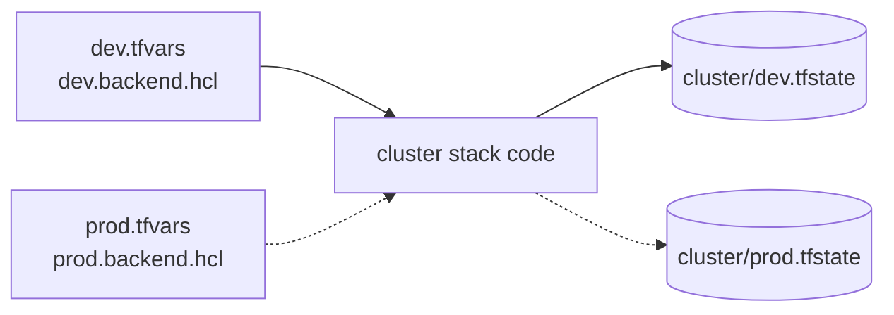
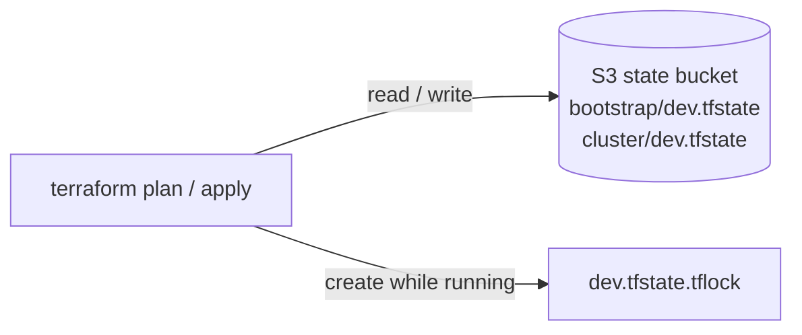

# Terraform design

## Stacks and modules



| Concept | Rule | Benefit |
|---|---|---|
| Stack | Has `backend.tf`, provider configuration and its own state | A failed or mistaken apply only affects that stack |
| Module | Declares minimum provider versions, no `provider` block, communicates only through variables and outputs | Reusable by any stack and environment |
| Composition | Modules are wired together in the stack (`module.network.public_subnet_ids` → `module.node`) | Dependencies are explicit and ordered automatically by Terraform |

## Environments

Each stack is deployed per environment with two files:

```
infrastructure/cluster/environments/
├── dev.tfvars          # input values
└── dev.backend.hcl     # state location: key = "cluster/dev.tfstate"
```



Environments share the code and differ only in data, so they cannot diverge in logic. Workspaces are not used, because they share one backend and one set of credentials across environments. A production environment would use its own AWS account and its own state bucket.

The backend block is a partial configuration (`backend "s3" {}`), since backend blocks cannot use variables; the environment's `.backend.hcl` is passed at `init`.

## State



| Control | Implementation | Benefit |
|---|---|---|
| Shared storage | S3 bucket created by the `bootstrap` stack | One source of truth for every operator and pipeline |
| Locking | `use_lockfile = true` (native S3 locking, no DynamoDB) | Concurrent runs are rejected instead of corrupting state |
| Versioning | Enabled, non-current versions expire after 90 days | Any previous state can be restored |
| Encryption | SSE-S3 at rest, `encrypt = true` in the backend, TLS-only bucket policy | State holds cluster PKI and must be protected in transit and at rest |
| Exposure | Public access block on all four settings | The bucket can never be made public by mistake |
| Deletion | `lifecycle { prevent_destroy = true }` | Terraform refuses to destroy the bucket |
| Unique name | `<project>-<env>-tfstate-<account-id>`, account ID read with `aws_caller_identity` | Globally unique without hardcoding |

The bootstrap stack was first applied with local state, after which both stacks were migrated into the bucket with `terraform init -migrate-state`.

## Versions

| Item | Pinning | Where |
|---|---|---|
| Terraform | Exact version | `.terraform-version` (tfenv), `required_version = ">= 1.16"` |
| Providers in stacks | `~> 6.69` (AWS), `~> 0.12` (Talos) | `versions.tf` |
| Providers in modules | Minimum only (`>=`) | Module `versions.tf` |
| Provider checksums | Committed lock file | `.terraform.lock.hcl` |
| Talos | Single variable `talos_version` | Drives the AMI lookup and the config contract |

Upgrades are explicit (`terraform init -upgrade`) and reviewed in a pull request.

## Conventions

| Convention | Example | Why |
|---|---|---|
| `for_each` over maps, not `count` | `aws_subnet.public["a"]`, `aws_instance.this["cp-a"]` | Stable addresses; removing one item never recreates others |
| `moved` blocks when refactoring | VPC moved from the stack into `module.network` | Refactors without destroying resources |
| `depends_on` only for hidden dependencies | S3 lifecycle rule after versioning; bootstrap after config apply | Terraform infers everything else from references |
| `lifecycle` where behaviour must be explicit | `prevent_destroy` on the state bucket, `ignore_changes = [ami]` on nodes | Protects critical data and in-place OS upgrades |
| Sensitive outputs | `kubeconfig`, `talosconfig` | Never printed in plans or logs |
| Default tags | `Project`, `Environment`, `ManagedBy = terraform` | Cost allocation and ownership on every resource |
| Variable validation | `environment` must be `dev`, `stage` or `prod` | Invalid input fails before any API call |
| Names | `<project>-<env>-<component>[-<qualifier>]` | Predictable names across console, tags and code |
| File layout | `versions.tf`, `main.tf`, `variables.tf`, `outputs.tf`, `backend.tf` | Every stack and module looks the same |
